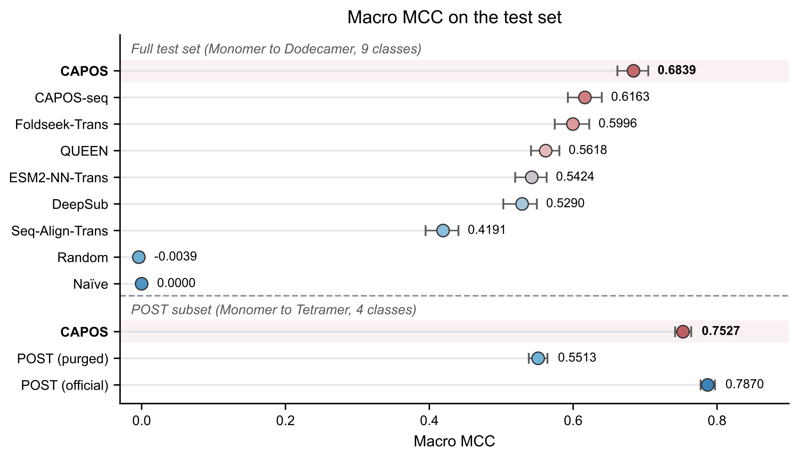

# CAPOS: A Context-Aware Gated Fusion Network for Protein Homo-Oligomeric State Prediction

[](LICENSE)
[](#-validation)
[](#-quick-start)
[](#-container-image-ghcr)

CAPOS predicts database-annotated homo-oligomeric states from protein sequences.
Sequence representations are extracted with ESM-S 650M, and structure-aware
representations are extracted with SaProt 650M from monomer structures predicted
by Chai-1. A learnable gated fusion module combines the two representations, and
a classification head assigns one of nine oligomeric states, from monomers to
dodecamers.

This repository contains the CAPOS source code, the CAPOS and CAPOS-seq
checkpoints, the benchmark datasets and analysis scripts, and a CPU-only
quickstart. The full-tier Singularity image is available from GHCR. The
quickstart applies the packaged classifiers to ten proteins with precomputed
features and does not require a GPU, the pretrained encoders, or network access.

## 📈 Performance



On the frozen test set (n = 14,418), CAPOS achieves a Macro MCC of 0.684:

| Method | Macro MCC |
|---|---:|
| **CAPOS** | **0.684** |
| CAPOS-seq | 0.616 |
| Foldseek-Trans | 0.600 |
| QUEEN | 0.562 |
| DeepSub | 0.529 |

CAPOS-seq is the sequence-only variant, which uses ProtT5-XL-UniRef50
embeddings with a refined DeepSub architecture. On the monomer-to-tetramer subset
(n = 13,480) used for comparison with POST, CAPOS achieves 0.753. POST achieves
0.787 with its official template library and 0.551 after templates sharing
MMseqs2 clusters with test sequences are removed. Error bars in the figure are
95% bootstrap confidence intervals.

The benchmark dataset was derived from PDB and UniProt annotations. PDB-derived
oligomers were filtered by the PISA subunit dissociation free energy at a
5 kcal/mol cutoff, and monomer models were required to satisfy pTM ≥ 0.5 and
pLDDT ≥ 70. The final splits contain 102,381 training, 14,407 validation, and
14,418 test sequences. Dataset construction is described in the manuscript.

## 🚀 Quick start

The quickstart requires Singularity CE and the full-tier image. It runs on CPU.
The ten proteins, their precomputed ESM-S, SaProt, and ProtT5 features, and the
reference predictions are in `quickstart/`.

### Clone and pull the image

The image is not stored in Git. Clone the source, pull the image from GHCR, and
run the quickstart:

```bash
git clone https://github.com/TingboWang/CAPOS.git
cd CAPOS

# optional: verify the source, data, and checkpoints
sha256sum -c checksums.sha256

mkdir -p images
singularity pull images/capos-full.sif \
  docker://ghcr.io/tingbowang/capos:full-20261026
./quickstart.sh
```

`quickstart.sh` uses `images/capos-full.sif` by default.

### Example output

The script runs both packaged classifiers and prints the predicted state and the
probability assigned to that state:

| ID | CAPOS | P(pred) | CAPOS-seq | P(pred) |
|---|---:|---:|---:|---:|
| 2A6C | 2 | 0.9095 | 2 | 0.9783 |
| 2BPS | 1 | 0.9412 | 1 | 0.9922 |
| 2DPK | 1 | 0.9439 | 1 | 0.9897 |
| 4ELO | 1 | 0.9873 | 1 | 0.9942 |
| A3D4P4 | 2 | 0.9998 | 2 | 0.9900 |
| A3PNM0 | 2 | 0.9983 | 2 | 0.9069 |
| C3KCR9 | 1 | 0.9997 | 1 | 0.9989 |
| P35354 | 2 | 0.7104 | 1 | 0.6860 |
| Q21C03 | 1 | 0.9931 | 1 | 0.8879 |
| Q5M551 | 1 | 0.9935 | 1 | 0.9975 |

The CSV files in `quickstart/out/` contain the sequences and all per-class
probabilities. The quickstart reads precomputed features and does not run
Chai-1 or feature extraction. `quickstart/reference_out/` contains reference
predictions for the same ten proteins and is not used by `quickstart.sh`. A
source-level runner, `quickstart/run_quickstart.sh`, performs the same CAPOS
check against `reference_out/` from a local installation.

## 🛠 Deployment

### Requirements

- Linux x86_64
- Singularity CE (validated with 4.3.1)
- CPU for the quickstart
- NVIDIA GPU and driver for `capos run`, the full fold-to-prediction pipeline
- At least 30 GB free disk for the image and pretrained weights
- Network access on the login node for the one-time weight download; compute
  nodes may be offline

### 🐳 Container image (GHCR)

The validated image is `images/capos-full.sif` (about 3.8 GB). It is public on
GHCR for Docker/OCI users:

```text
ghcr.io/tingbowang/capos:full-20261026   # release tag
ghcr.io/tingbowang/capos:full
```

Manifest digest:
`sha256:ed8d60e08757637e14b3a95b99645e28c66f9adf530b7918cd98da00da8fcfa4`

The previous `full-20261025` tag remains available for rollback.

Docker execution was not validated in this release. The validated deployment
path is the SIF with `quickstart.sh`.

### 📦 What is in the image?

| Component | Included |
|---|---|
| CAPOS source and command-line interface | Yes |
| `capos_model.pth` and `capos-seq_model.pth` | Yes, at `/opt/capos/weights/` |
| ESM-S, SaProt, and ProtT5 runtime stack | Yes |
| Chai-1 and Foldseek | Yes |
| Feature-extraction and training dependencies | Yes |
| Pretrained encoders and Chai-1 weights (~22 GB) | No; mount at `/opt/capos/pretrained_weights` |

The quickstart does not require the 22 GB of pretrained weights because it starts
from precomputed features. Full prediction requires them as described below.

### Pretrained weights

The image contains the CAPOS checkpoints but not the ESM-S, SaProt, ProtT5, or
Chai-1 assets. Download them on a login node with network access:

```bash
# from the repository root, in a Python environment with huggingface_hub
./download_weights.sh --components esm-s,saprot,prott5,chai1
./download_weights.sh --components esm-s,saprot,prott5,chai1 --verify-only
```

This creates `pretrained_weights/` at the repository root:

```text
esm-s/       ESM-2 650M base and ESM-S checkpoint
saprot/      SaProt 650M PDB weights and code snapshot
prott5/      ProtT5 XL half encoder (CAPOS-seq)
chai1/       Chai-1 assets and ESM-2 3B HuggingFace cache
foldseek/    Foldseek binary (optional; the image ships its own)
```

The full-tier image already contains Foldseek, so the command above omits the
source-built `foldseek` component. The default invocation downloads and builds
it for installations outside the image; the build requires cmake, make, a C++
compiler, Rust/cargo, and the zlib/bzip2 headers. The downloader also writes
`pretrained_weights/capos_env.sh` with the corresponding environment variables.
If a populated `pretrained_weights/` directory is already available, it can be
reused directly.

### Mount the weights

The image expects the assets at `/opt/capos/pretrained_weights`:

```bash
WEIGHTS=/absolute/path/to/pretrained_weights
```

The image sets `CAPOS_ESMS_MODEL`, `CAPOS_ESMS_CKPT`, `CAPOS_SAPROT_MODEL`,
`CAPOS_SAPROT_REPO`, `CAPOS_PROTT5_MODEL`, and `CHAI_DOWNLOADS_DIR` to paths
under that mount. Foldseek is bundled at `/opt/foldseek/bin/foldseek`.

### Run on a GPU node

On a Slurm cluster, request a GPU for example with:

```bash
srun --gres=gpu:1 --cpus-per-task=8 --mem=32G --pty bash
```

The full pipeline folds one sequence at a time. GPU memory requirements increase
with sequence length. For offline compute nodes, set `HF_HUB_OFFLINE=1` and
`TRANSFORMERS_OFFLINE=1`, and set `HF_HOME` and `TRANSFORMERS_CACHE` to
`/opt/capos/pretrained_weights/chai1/esm`. The `capos run` example below passes
these variables with `--env`.

## 🧬 Prediction

### CAPOS: sequence and structure-aware

Create a one-sequence FASTA:

```bash
mkdir -p input out
cat > input/query.fasta <<'EOF'
>my_protein
MKTIIALSYIFCLVFADYKDDDDK
EOF
```

Run the complete fold, featurize, and predict pipeline:

```bash
WEIGHTS=/absolute/path/to/pretrained_weights

singularity exec --nv --cleanenv --pwd /data/out \
  --bind "$PWD/input":/data/input:ro \
  --bind "$WEIGHTS":/opt/capos/pretrained_weights \
  --bind "$PWD/out":/data/out \
  --env CUDA_VISIBLE_DEVICES="${CUDA_VISIBLE_DEVICES:-0}" \
  --env HF_HUB_OFFLINE=1 \
  --env TRANSFORMERS_OFFLINE=1 \
  --env HF_HOME=/opt/capos/pretrained_weights/chai1/esm \
  --env TRANSFORMERS_CACHE=/opt/capos/pretrained_weights/chai1/esm \
  images/capos-full.sif capos run \
    /data/input/query.fasta \
    --work-dir /data/out \
    --workers 1
```

The result is `out/capos_predictions.csv`, with the predicted state and
per-class probabilities. Intermediate Chai-1 structures and features are
written under `out/`.

`--pwd /data/out` provides a writable working directory. The SIF root filesystem
is read-only, and some helper scripts write temporary files relative to the
current directory.

### CAPOS-seq: sequence-only with ProtT5

CAPOS-seq skips structure prediction. Create a CSV:

```bash
mkdir -p input out
cat > input/query.csv <<'EOF'
ID,Sequence
my_protein,MKTIIALSYIFCLVFADYKDDDDK
EOF
```

Extract ProtT5 features:

```bash
WEIGHTS=/absolute/path/to/pretrained_weights

singularity exec --nv --cleanenv --pwd /data/out \
  --bind "$PWD/input":/data/input:ro \
  --bind "$WEIGHTS":/opt/capos/pretrained_weights \
  --bind "$PWD/out":/data/out \
  --env CUDA_VISIBLE_DEVICES="${CUDA_VISIBLE_DEVICES:-0}" \
  --env HF_HUB_OFFLINE=1 \
  --env TRANSFORMERS_OFFLINE=1 \
  images/capos-full.sif capos featurize \
    --input /data/input/query.csv \
    --out-dir /data/out/features \
    --prott5-model /opt/capos/pretrained_weights/prott5/prot_t5_xl_half_uniref50-enc
```

Run the sequence-only classifier:

```bash
singularity exec --cleanenv --pwd /data/out \
  --bind "$PWD/out":/data/out \
  images/capos-full.sif capos predict --model capos-seq \
    --seq-feat /data/out/features/prott5.h5 \
    --weights /opt/capos/weights/capos-seq_model.pth \
    --out /data/out/predictions_seq.csv
```

The outputs are `out/features/prott5.h5` (1024-dimensional embeddings) and
`out/predictions_seq.csv`. The `--nv` flag uses a GPU when available; it can be
omitted to run featurization on CPU.

## 🧰 Installation from source

The Singularity image is the validated deployment. To run the source directly:

```bash
conda env create -f environment.yml
conda activate capos
pip install -e .
./quickstart/run_quickstart.sh
```

The source-level runner writes `quickstart/run_out/` and compares the
predictions with `quickstart/reference_out/`. The full fold pipeline also
requires the Chai-1 environment in `environment_chai1.yml`, the pretrained
weights, and a Foldseek binary (the default downloader builds one). Environment
variables for the weights are written to `pretrained_weights/capos_env.sh`. When
the Chai-1 environment is not active, `CAPOS_CHAI1_CMD` must point to `chai-lab`
in that environment. The training entry point is `capos train`; install the
training extras with `pip install -e '.[train]'` and run `capos train --help`
for its arguments.

## 📂 Repository layout

```text
CAPOS/
├── README.md
├── LICENSE
├── checksums.sha256
├── quickstart.sh              # image-based inference demo
├── download_weights.sh        # pretrained-weight downloader
├── pyproject.toml
├── Dockerfile
├── .dockerignore
├── environment.yml
├── environment_chai1.yml
├── capos/                     # CLI, model definitions, prediction, and training
├── tools/                     # ESM-S, SaProt, and ProtT5 extraction; fold preparation
├── weights/                   # capos_model.pth and capos-seq_model.pth
├── quickstart/
│   ├── example_data/          # ten proteins and precomputed features
│   ├── reference_out/         # reference predictions
│   ├── run_quickstart.sh      # source-level runner
│   ├── make_example_data.py   # construction of the example fixture
│   └── README.md
├── images/                    # capos-full.sif (pulled from GHCR)
├── pretrained_weights/        # generated by download_weights.sh (git-ignored)
└── supplementary/
    ├── benchmark/             # baseline implementations, bootstrap analysis, and figure
    ├── datasets/              # benchmark datasets and split assignments
    └── analysis_scripts/      # analysis scripts for the paper and Supplementary Materials
```

The benchmark prediction outputs are generated by the baseline scripts and are
not tracked. The benchmark datasets are tracked.

The `supplementary/analysis_scripts/` directory contains the analysis scripts
used for the paper and Supplementary Materials; its README maps each analysis
to the corresponding figure or table. The scripts are not required for
inference.

## ✅ Validation

| Check | Result |
|---|---|
| Quickstart, CAPOS | **10/10** labels match `reference_out/`; max \|ΔP\| = 0 |
| Quickstart, CAPOS-seq | **10/10** labels match `reference_out/`; max \|ΔP\| = 0 |
| Full fold to prediction, ten proteins | **10/10** on an RTX 3090; 24m47s |
| Training check, CPU and GPU | Completed; checkpoints and validation reports written |
| Docker runtime | Not validated |

The quickstart and full-pipeline runs were validated with Singularity CE 4.3.1
on an RTX 3090 node.

## 🧾 Checksums

`checksums.sha256` covers the source tree, checkpoints, quickstart data and
reference outputs, benchmark code and figure, datasets, and analysis scripts.
The SIF image is distributed through GHCR and is not included in the checksum
file.

## 📜 License

CAPOS source code and the checkpoints in `weights/` are released under the MIT
License; see [`LICENSE`](LICENSE). The pretrained encoders and Chai-1 assets
follow their upstream licenses.
